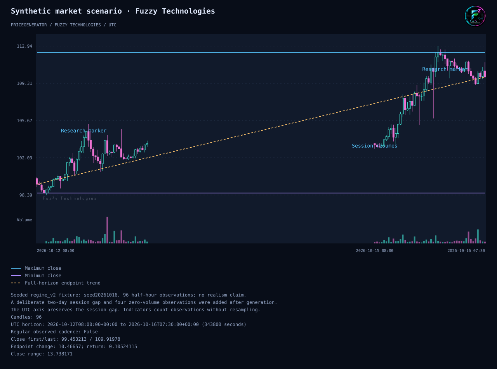
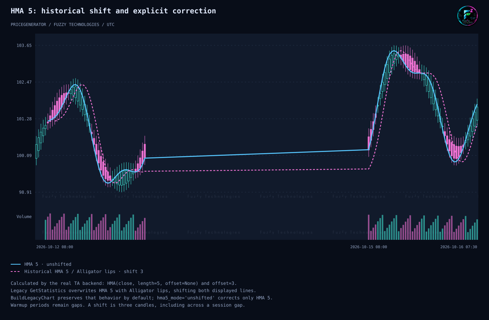

# Modern charts and migration from Google/Bokeh

The development branch provides two new offline outputs: a standalone SVG and
an interactive Canvas chart with its JavaScript and logos embedded in one HTML
file. Both use the Fuzzy Technologies dark palette by default. Neither output
needs Google Charts, Bokeh, Jinja, a CDN, a browser installation, or a server to
be generated. Interactive viewing needs a JavaScript-capable browser.

The chart specification and renderers use Python's standard library. DataFrame
adapters explicitly use pandas. Full historical analysis explicitly requires
`pricegenerator[indicators]`; notebook display requires `pricegenerator[notebook]`.
These are development-branch APIs, not a claim that the currently published
PyPI release already contains this migration.

## Start with existing prices

```python
from pricegenerator.rendering.adapters import FromDataFrame, SaveMarkdown
from pricegenerator.rendering.interactive import SaveInteractive
from pricegenerator.rendering.static import SaveSVG

# prices is an existing DataFrame with datetime, open, high, low, close, volume.
# Datetimes with offsets retain their absolute times. Naive dates need a policy.
chart = FromDataFrame(
    prices,
    assume_timezone="Europe/Moscow",  # omit when every timestamp is already aware
    title="Research scenario",
    summary=("Synthetic research data; no market-realism claim.",),
)
SaveSVG(chart, "scenario.svg")
SaveInteractive(chart, "scenario.html")
SaveMarkdown(chart, "scenario.md")
```

The three save operations are explicit and independent. I/O errors propagate.
There is no implicit file write, browser launch, shell command or network
request. `RenderSVG`, `RenderInteractive`, and `RenderMarkdown` return strings
when the caller wants to manage storage or a surrounding report itself.

`FromDataFrame` snapshots the required columns and does not run indicators or
modify prices. It accepts a single candle, zero volumes, negative prices and
zero closes if the OHLC geometry is valid. It rejects missing/nonfinite values,
unordered or duplicate candle timestamps, and timestamps finer than one
millisecond. Naive times require `assume_timezone`; DST ambiguity and nonexistent
civil times are rejected. No implicit machine timezone or epoch-unit guess is used.



## Preserve the old overlays and statistics

```python
from pricegenerator.rendering.adapters import BuildLegacyChart, SaveMarkdown
from pricegenerator.rendering.interactive import SaveInteractive

# model is an existing PriceGenerator instance with model.prices populated.
chart = BuildLegacyChart(
    model,
    assume_timezone="UTC",  # use the actual timezone of naive source data
    include_statistics=True,
    hma5_mode="legacy",
)
SaveInteractive(chart, "analysis.html")
SaveMarkdown(chart, "analysis.html.md")
```

The adapter copies the existing model, price table and statistics before
calling its real `GetStatistics`. It does not construct a new generator or
consume the process's Python/NumPy random state. The caller's prices, existing
statistics, precision, timeframe, horizon and title remain unchanged. Array
outputs become detached `ChartSpec` values.

All legacy report lines survive: candle count, timeframe, precision, first/last/
maximum/minimum closes, close range and trend, up/down counts and percentages,
longest runs, range extrema and standard deviation, 99/95/80 percentiles, and
total volume. The report retains historical calculation semantics, including
known legacy quirks; this adapter does not silently redefine statistics.

| Historical capability | New adapter behavior |
| --- | --- |
| Candles and linked volume | Preserved through the shared validated OHLCV snapshot |
| Max/min close and labels | Visible horizontal lines; labels contain exact rounded limits |
| Full and split trends | Visible lines interpolated by elapsed UTC time within each segment |
| Midpoint line and points | Both retained, initially hidden |
| SMA 5/20/50/200 | Four actual legacy vectors and grouped visibility |
| HMA 5/20 | Historical HMA5 shift preserved by default; explicit correction described below |
| VWMA 5/20 | Actual vectors; undefined zero-volume results remain gaps |
| Bollinger lower/mid/upper | Three separate lines, preserving the old unfilled-band behavior |
| PSAR long/short | Separate point series with original gaps |
| Alligator | Actual historical HMA13/8/5 with offsets 8/5/3; never relabeled as standard SMMA |
| Zig-Zag | Original selected endpoints, connected by elapsed-time interpolation; no extrapolation |
| Warmup periods | `None` gaps, without invented values |
| Visibility | Price limits/trends and custom lines visible; other analysis groups initially hidden |
| Controls | `show_controls=False` hides controls while preserving supplied data and initial visibility |
| Report/Markdown | Original text retained in HTML/SVG and explicitly exportable as Markdown; PNG is chart-only |

`include_statistics=False` skips `GetStatistics`, all automatic overlays and
the automatic report; custom annotations still work. This mode requires no
indicator backend. Full historical analysis currently requires at least five
candles and nonzero closes because the legacy formulas do. Use `FromDataFrame`
or disable statistics for raw charts outside that analysis domain. Invalid
split counts raise an error instead of drawing a guessed trend.

### HMA5 migration is an explicit choice

The historical method calculates an unshifted HMA5, then overwrites it with
the Alligator lips series at offset 3. Both old chart groups read the overwritten
column. The default `hma5_mode="legacy"` preserves this actual output and labels
the shift. Choosing `hma5_mode="unshifted"` calculates HMA5 without an offset
using the installed TA backend. The Alligator lips remain shifted by three
candles in both modes. The new adapter does not silently change that formula.



This illustration uses the real backend on deterministic analytical prices,
not a hand-drawn approximation or an investment recommendation. Reproduce both
figures from the repository root, using an installed development environment
with the indicators extra (`tools` is a repository module, not part of the wheel):

```bash
python -m tools.chart_examples --output-dir docs/examples
# Optionally generate the standalone interactive counterparts locally:
python -m tools.chart_examples --output-dir /tmp/pricegenerator-examples --html
```

## Custom lines and text markers

The historical DataFrame formats remain useful:

```python
import pandas as pd
from pricegenerator.rendering.adapters import FromDataFrame

markers = pd.DataFrame({
    "datetime": [prices.datetime.iloc[10], prices.datetime.iloc[20]],
    "markersUpper": ["Candidate entry", ""],
    "markersCenter": ["", "Observation"],
    "markersLower": ["", "Candidate exit"],
})
line = pd.DataFrame({"datetime": prices.datetime, "Reference": reference_values})
chart = FromDataFrame(prices, markers=markers, lines=[line])
```

Markers are plain text. Their positions are above the high, at the candle's
midpoint, or below the low using screen-space spacing instead of a fixed `0.5`
price offset. Empty/missing marker text is omitted; numeric labels must be
converted to strings explicitly.

Custom frames can contain a subset of candle times, in any order. Alignment is
by exact normalized timestamps, never index position. Unknown or duplicated
timestamps are rejected. Every named numeric column in a custom-line frame
becomes an overlay. Missing values and omitted timestamps create gaps; there
is no hidden interpolation. Supply a fully aligned interpolated series when
that is the intended scientific meaning. Advanced callers can pass explicit
`ChartSeries` objects in `FromDataFrame(..., series=...)` for points, colors,
group names, widths and dashed lines.

## CSV command

The modern chart command reads existing data and produces the new outputs:

```bash
python -m pricegenerator.rendering prices.csv --svg prices.svg --html prices.html
python -m pricegenerator.rendering old-prices.csv --legacy-csv --timezone Europe/Moscow --html prices.html
python -m pricegenerator.rendering prices.csv --line reference.csv --markers markers.csv --theme dark --svg annotated.svg
```

The default CSV has headers `datetime,open,high,low,close,volume`.
`--legacy-csv` reads headerless `date,time,open,high,low,close,volume`; historical
dot-separated and ISO dates, with minute or second time fields, are supported.
Naive input needs `--timezone`. `--summary` is repeatable, and `--report` writes
those supplied notes to Markdown. Without supplied notes, it reports the candle
count and explicitly identifies the chart as raw OHLCV. This command does not
calculate the full historical technical report; use `BuildLegacyChart` for it.

At least one `--svg`/`--html` output is required. Output paths must differ from
each other and all input paths. Missing parent directories or write failures
propagate. The original generation CLI remains available; its Google/Bokeh
options are compatibility paths, while the command above selects the new
renderer explicitly. No published CLI default is silently changed.

## Notebook display

```python
from pricegenerator.rendering.adapters import DisplayChart

DisplayChart(chart)               # isolated offline HTML iframe
DisplayChart(chart, format="svg") # static inline SVG
```

Display is explicit. `DisplayChart` lazily loads IPython and returns its display
handle. `NotebookHTML(chart)` returns the iframe markup without importing
IPython or displaying anything. Each interactive chart has its own document so
multiple cells cannot collide through fixed DOM IDs or JavaScript globals.
The iframe allows its own scripts and export downloads while withholding the
parent origin. The notebook frontend must permit trusted iframe output; frontend
security policies can suppress HTML execution. SVG is the script-free fallback.

## Replacement limits and evidence

The former arbitrary Google Jinja template/model hooks are not executed by the
new specification. Compose a trusted outer report around the returned chart
instead. Rendering types are now immutable specifications/strings/paths, not
Bokeh layout objects or browser handles. Static exports display only initially
visible series; interactive charts offer group controls and PNG export. The
interactive PNG includes the chart, visible overlays and branding, but not the
external HTML summary or control buttons. Unlike the old Bokeh in-canvas legend,
the modern statistics report is outside that canvas. Use SVG, the complete HTML
or Markdown to preserve the full report. This is an explicit export-scope change,
not pixel-for-pixel parity. Native
Python static PNG/PDF conversion and filled Bollinger areas are outside this
first API. Legacy engines remain available until deliberate retirement.

The migration tests exercise real indicator vectors, complete reports,
timestamp alignment, zero volume, analysis limits, input/RNG preservation,
escaped text, explicit notebook dispatch, CSV conversion and write failures.
The specification, SVG, JavaScript interaction and package tests provide their
own evidence. Performance is a separate [measured workload](chart-performance.md),
not a speed claim inferred from a smaller dependency list. Task #94 is complete
only after the combined installed-package, offline/export and performance gates
pass; these adapters alone do not establish full replacement acceptance.
