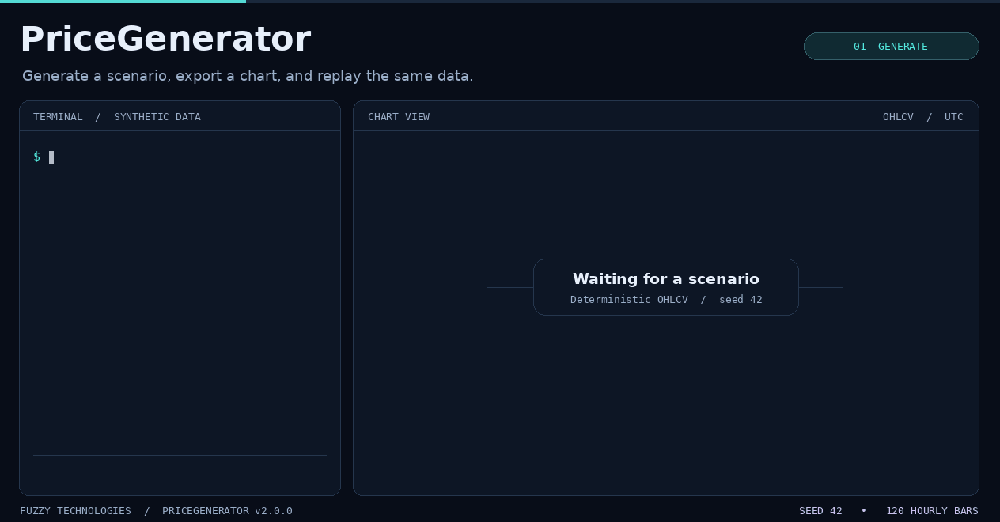

# Generate, chart, and replay a scenario



The demo uses the installed [PriceGenerator v2.0.0 pre-release](https://github.com/Fuzzy-Technologies/PriceGenerator/releases/tag/v2.0.0) with the `export` extra. It creates 120 hourly OHLCV candles with seed 42, writes the manifest, exports the native PNG and checks the replayed CSV byte for byte. The status lines annotate verified files. The animation progressively reveals the actual exported candles and their volume bars.

## Commands

Run these from a writable directory with the package installed. The last command uses a POSIX shell.

```bash
pricegenerator generate --seed 42 \
  --horizon 120 --output prices.csv \
  --manifest scenario.json
pricegenerator chart prices.csv \
  --output chart.png --width 790 \
  --height 460 --no-view
pricegenerator replay scenario.json \
  --output replay.csv
cmp prices.csv replay.csv
```

## Open the same candles with indicator buttons

With the 2.2 checkout installed, run this command on `prices.csv` and open `analysis.html`.

```sh
pricegenerator chart prices.csv --analysis --output analysis.html --no-view
```

**Want indicator buttons?** Rebuild the HTML from the same CSV with
`--analysis` (or use `Chart(prices, "chart.html", analysis=True)` in Python).
Open the HTML in your browser. Click **Bollinger bands** to see the price
envelope, **SMA 50 / 200** to compare moving averages, or **Midpoint** to mark
the middle of each candle's high–low range. Other groups include HMA, VWMA,
PSAR, Alligator and Zig-Zag. Expand **Individual series** to toggle one line
at a time. SMA 200 needs at least 200 candles.

Use the wheel or **Box zoom** to focus on an interval. Switch to **Light theme**
if you prefer, or download the current view with **Export PNG**. The brief
overview sits below the chart. Expand **Detailed statistics** for the full report.

The screenshot uses 240 hourly candles with the same seed. In the 120-candle
recording above, SMA 50 can draw while SMA 200 has too few observations.

```sh
pricegenerator generate --seed 42 --horizon 240 --start 2025-01-06T00:00:00Z --timeframe-seconds 3600 --output example-240.csv
pricegenerator chart example-240.csv --analysis --title "Synthetic hourly candles · seed 42" --output example-240.html --width 1120 --height 510 --no-view
```

For the screenshot, turn on **Bollinger bands** and **SMA 50 / 200**.


## Regenerate the recording

Run the recorder with an isolated installation of the [v2.0.0 source tag](https://github.com/Fuzzy-Technologies/PriceGenerator/tree/v2.0.0), the tag's modern dependency constraints and Linux DejaVu Sans fonts in `/usr/share/fonts/truetype/dejavu`. It runs the installed CLI in a temporary directory and stops if replay changes the CSV bytes.

```bash
python -I tools/record_cli_demo.py docs/assets/pricegenerator-cli-demo.gif
```

The checked-in recording uses CPython 3.12, pandas 2.2.3, NumPy 2.2.6, Pillow 12.0.0 and resvg-py 0.5.0. The input and replay matched at SHA-256 `7dfc39216f109d1aaf74363e55450b1d9629332295bc2d5b00ca606c0d58b022` in this environment. Font and raster dependencies can change pixels on other systems.
