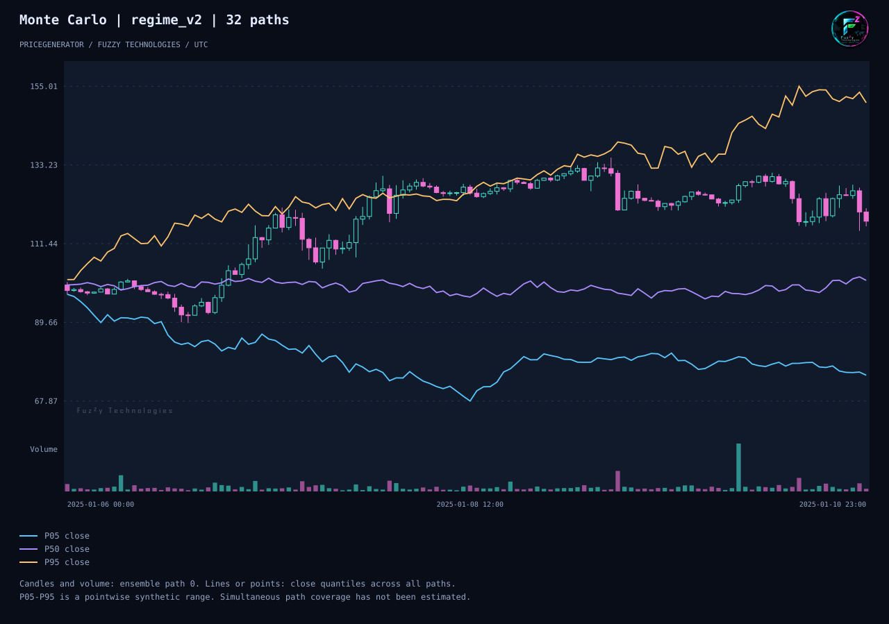

# PriceGenerator 2.2.0

[English](release-2-2.md)

PriceGenerator строит синтетические свечи для тестирования торговых систем.
В 2.2 можно сравнить сгенерированный ряд с рыночной историей и увидеть,
где они расходятся. А ещё можно передать коллеге весь эксперимент, чтобы
он получил те же свечи, графики и результаты сравнения у себя.

## Что добавилось после 2.1

- **Сравнение двух рядов.** Дай программе два CSV с одинаковым таймфреймом.
  Она покажет, насколько различаются волатильность, просадка, объём и другие
  показатели. Для каждого показателя можно задать допустимое расхождение.
- **Готовый пример для обмена результатами.** Он создаёт два синтетических
  ряда и сохраняет настройки, отчёт и графики вместе. По этим настройкам
  можно повторить эксперимент и проверить результат.
- **Русские руководства.** Переписали быстрый старт и инструкции о том,
  как работать со свечами, повторять прогоны и обмениваться данными с MetaTrader 5.

## Как читать график

Мы 32 раза запустили один сценарий с одинаковыми настройками. Случайные
движения цен в каждом прогоне были свои. Свечи и объём показывают один
прогон, а три линии собирают результаты всех 32 прогонов по часам.



Возьмём последний час. У нас есть 32 цены закрытия. Сортируем их от
меньшей к большей. Фиолетовая линия показывает середину ряда — **101,27**.
Голубая и жёлтая показывают границы центральных 90% распределения —
примерно **от 75,01 до 150,46** в этот час. Для соседнего часа расчёт идёт
заново, и положение линий могут определять уже другие прогоны. Так видно,
какой разброс цен даёт один набор настроек.

## Попробовать

Из окружения с установленным PriceGenerator 2.2 сгенерируй 120 часовых
свечей и открой получившийся HTML в браузере. График работает офлайн.

```sh
pricegenerator generate --seed 42 --horizon 120 --timeframe-seconds 3600 --output candles.csv
pricegenerator chart candles.csv --output candles.html --no-view
```

[Полный пример эксперимента](examples/experiment-bundle.md) ·
[Сравнение двух CSV](reference-comparison.md) ·
[Переход с 1.4.93](site/content/ru/migrate-to-2-1.md) ·
[Технические результаты проверки](evidence/pricegenerator-2-2-experiment.md)
