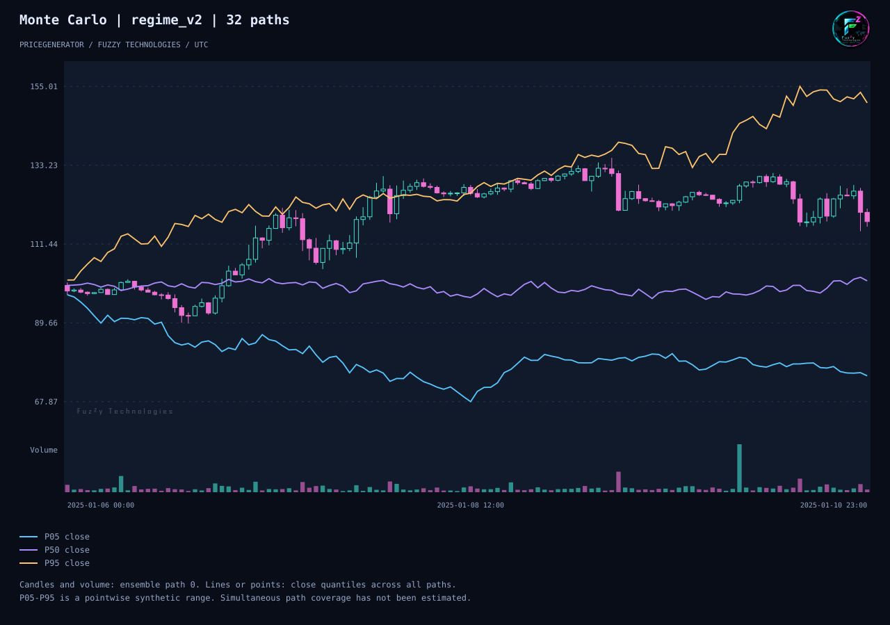

# PriceGenerator 2.2.0

[English](release-2-2.md) · [Русский](release-2-2-ru.md)

PriceGenerator 为交易系统测试生成可复现的合成 K 线。2.2 可以比较两份同周期
的 OHLCV 数据，查看波动率、回撤和成交量等指标的差异。你也可以把配置、数据、
对比结果和图表一起交给同事，让对方复现整个实验。

- **对比两份数据。** 指定 K 线周期，并按需为各项统计指标设置容差。
- **分享实验。** 保存种子和清单，复现单条价格轨迹或整组蒙特卡洛模拟。
- **查看不同模拟结果。** 蜡烛和成交量来自一次模拟，三条分位数曲线汇总同一时刻
  32 次模拟的收盘价。



默认生成整数形式的合成活跃度计数。导入的资产成交量保留原有精度。

## 试用交互图表

安装 PriceGenerator 2.2 后，生成 240 根小时 K 线，然后用浏览器打开本地 HTML。

```sh
python -m pip install pricegenerator==2.2.0
pricegenerator generate --seed 42 --horizon 240 --start 2025-01-06T00:00:00Z --timeframe-seconds 3600 --output candles.csv
pricegenerator chart candles.csv --output candles.html --analysis --no-view
```

**如何显示指标按钮？** 用同一份 CSV 重新生成 HTML，并加上 `--analysis`。
在 Python 中可以调用 `Chart(prices, "chart.html", analysis=True)`。
用浏览器打开文件后，点击 **Bollinger bands** 查看均线周围的波动范围，
点击 **SMA 50 / 200** 比较两条均线，或点击 **Midpoint** 标出每根 K 线
最高价与最低价的中点。还可以切换 HMA、VWMA、PSAR、Alligator 和 Zig-Zag。
展开 **Individual series** 可以单独开关一条曲线。SMA 200 至少需要 200 根 K 线。

用滚轮或 **Box zoom** 放大选定区间。**Light theme** 切换至浅色主题，
**Export PNG** 保存当前视图。图表下方显示简要概览，展开
**Detailed statistics** 可查看完整报告。


[快速入门](site/content/zh-CN/quick-start.md) · [完整实验](examples/experiment-bundle.md)
