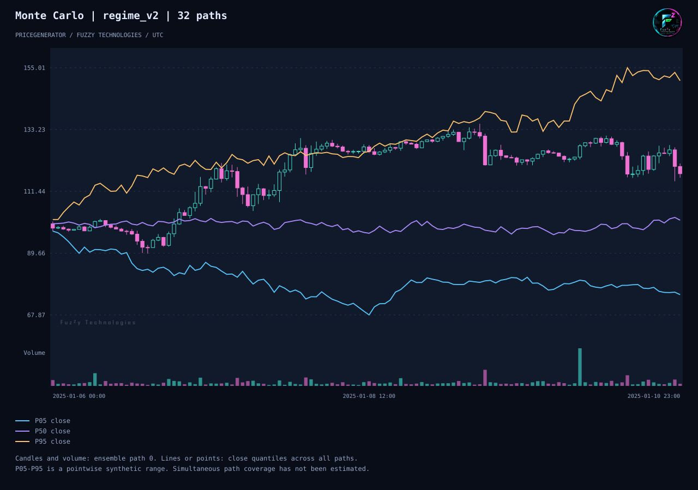

# PriceGenerator 2.2.0

[Русский](release-2-2-ru.md)

PriceGenerator makes synthetic market candles for testing trading systems.
In 2.2 you can put a historical series beside a generated one and see
where they differ. You can also share a complete experiment so a colleague
can reproduce the same candles, charts and comparison.

## What changed since 2.1

- **Compare two price series.** Give PriceGenerator two CSV files with the
  same candle interval. It shows how they differ in volatility, drawdown,
  volume and other measures. You can set how large a difference you are
  willing to accept for each measure.
- **Share an experiment.** The worked example creates two synthetic series
  and saves the settings, comparison and charts together. A colleague can
  use the saved settings to replay the experiment and check the results.
- **Get started in Russian.** The quick start and guides now explain how to
  work with candles, reproduce a run and exchange data with MetaTrader 5
  using familiar market-data terms.

## How to read the chart

We ran the same scenario settings 32 times, with different random price
moves in each run. The candles and volume show one run. The three lines
summarize the closing prices across all 32 runs, one hour at a time.



Pick the last hour. Sort its 32 closing prices from lowest to highest.
The purple line marks the middle at **101.27**. The blue and yellow lines
mark the lower and upper edges of the central 90% of the distribution,
roughly **75.01 to 150.46** for that hour. At another hour, different runs
can set those marks. The spread helps you see how far outcomes can vary
under the same scenario settings.

## Try it

With PriceGenerator 2.2 installed, generate 120 hourly candles and open
the resulting HTML chart in your browser. The chart works offline.

```sh
pricegenerator generate --seed 42 --horizon 120 --timeframe-seconds 3600 --output candles.csv
pricegenerator chart candles.csv --output candles.html --no-view
```

[Run the full experiment](examples/experiment-bundle.md) ·
[Compare two CSV files](reference-comparison.md) ·
[Upgrade from 1.4.93](site/content/en/migrate-to-2-1.md) ·
[Verification details](evidence/pricegenerator-2-2-experiment.md)
