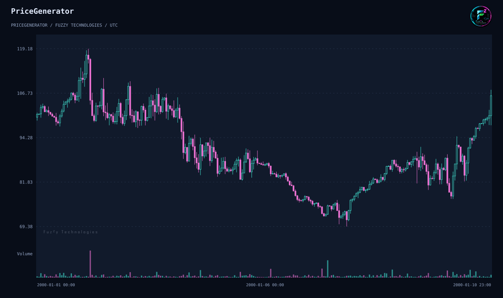
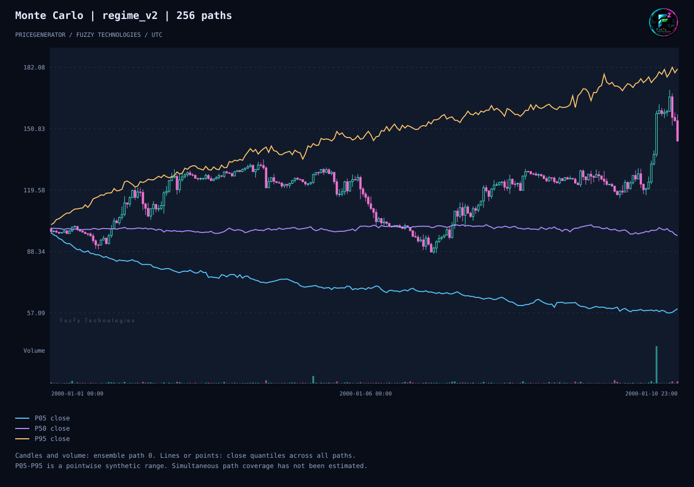

# PriceGenerator 2.1 release preview

[Русский](../ru/release-2-1.md) · [简体中文](../zh-CN/release-2-1.md)

The historical PyPI 1.4.93 package uses the mutable generator and legacy
renderers. The GitHub 2.0.0 test tag introduced immutable configuration,
seeded OHLCV, exact scenario replay, streaming and modern charts. The first
public 2.x release target, 2.1.0, adds reproducible Monte Carlo experiments,
optional fuzzy diagnostics and measured export improvements.

## Reproduce one scenario

Use an isolated installation of the reviewed 2.1 development build with
CPython 3.10–3.13. See the [quick start](quick-start.md) for the 2.0 baseline
and [migration](migrate-to-2-1.md) for compatibility and install guidance.

```sh
pricegenerator generate --seed 42 --horizon 240 --output prices.csv --manifest scenario.json
pricegenerator replay scenario.json --output replay.csv
pricegenerator validate prices.csv --timeframe-seconds 3600 --no-gaps
pricegenerator analyze prices.csv --output statistics.json
pricegenerator chart prices.csv --output scenario.svg --no-view
pricegenerator chart prices.csv --analysis --output scenario.html --no-view
```



The initial open is 100, the final close is 106.02, and the maximum drawdown
over closes is 39.30%. Replay reproduced the canonical CSV byte for byte.
The offline HTML includes the analysis; the SVG shows the price and volume.

## Replay 256 Monte Carlo paths

```sh
pricegenerator monte-carlo --seed 42 --horizon 240 --paths 256 --workers 2 --output ensemble.json --manifest experiment.json --chart quantiles.html
pricegenerator replay-ensemble experiment.json --workers 1 --output replayed-ensemble.json --chart quantiles.svg
```



The final close quantiles were 59.22, 96.46 and 181.26. The corresponding
quantiles of maximum drawdown across paths were 15.56%, 31.00% and 52.18%.
Replay with one worker matched the two-worker report byte for byte. Close
quantiles are pointwise, conditional on `regime_v2`; they do not specify
simultaneous path coverage. See the [ensemble contract](../../../monte-carlo.md).

## Optional scalar diagnostics

Use the `fuzzy` extra on CPython 3.13. With FuzzyRoutines 2.1.0, the
[documented Mamdani example](../../../fuzzy-diagnostics.md) returns a
score of about 0.587 and the rule trace. The two inputs are ratios to
reference volatility and activity. The score summarizes the supplied
inputs and does not change generated candles. The
[Bitstamp holdout](../../../evidence/reference-bitstamp-holdout.md) reports
limits of the restricted simulation fit and a descriptive fuzzy check.

## Compatibility and evidence

| Area       | 1.4.93                  | 2.1                                                                             |
| ---------- | ----------------------- | ------------------------------------------------------------------------------- |
| Generation | Mutable generator       | `GenerationConfig`, `Generate`, and chunked adapters                            |
| CLI        | Historical flags        | Subcommands and versioned replay manifests                                      |
| Charts     | Legacy renderer methods | Offline HTML, SVG, optional PNG and JPEG                                        |
| Research   | Historical statistics   | Versioned experiments, drawdowns, pointwise quantiles and optional fuzzy traces |

The two figures are exports of the commands above on the 2.1.0.dev0
review build, CPython 3.12.14, NumPy 2.2.6 and pandas 2.2.3. The initial
CLI [animation](../../../examples/cli-demo.md) is a separate 2.0.0 test-tag
recording. See the [scientific guide](scenario-guide.md) for assumptions,
MT5 data exchange, and the generated API reference. Release promotion and
PyPI publication follow the [maintainer runbook](../../../releasing.md).
