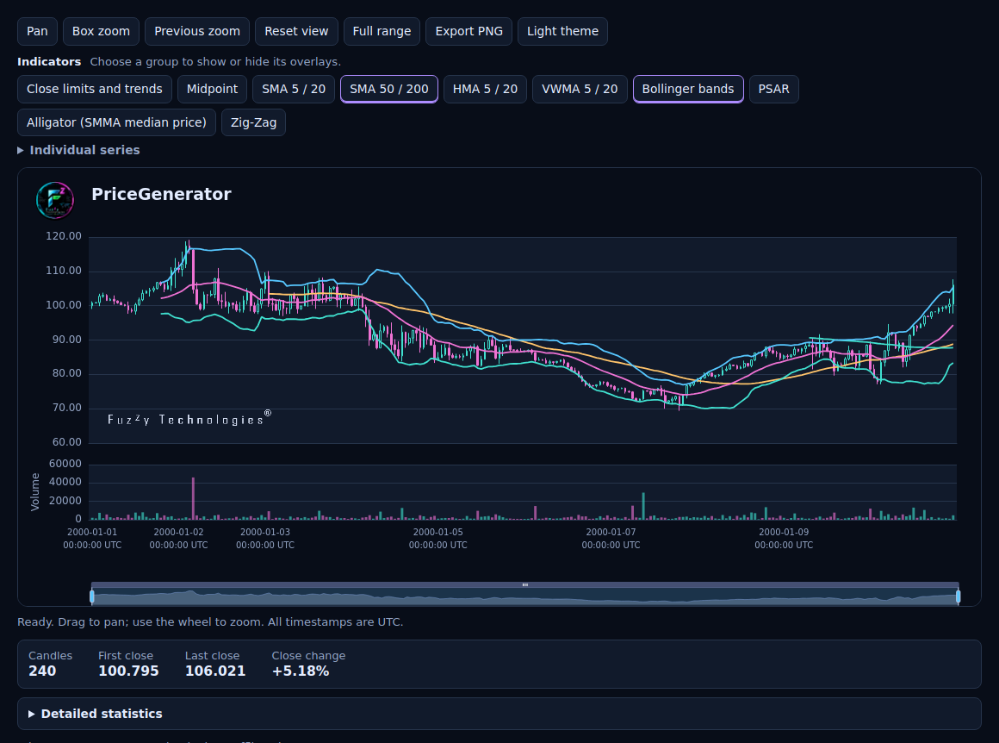

# Synthetic OHLCV scenarios and their limits

[Русский](../ru/scenario-guide.md) · [简体中文](../zh-CN/scenario-guide.md)

Start with the [quick start](quick-start.md) to generate, replay and export a
minute-bar fixture from the verified GitHub 2.0 test baseline. The
[migration guide](migrate-to-2-1.md) covers the 2.1.0 GitHub pre-release.

## Interpret the candles

The portable table has six columns in order:
`datetime,open,high,low,close,volume`. Timestamps are unique, increasing
UTC instants with nanosecond precision. Prices and volume are finite
binary64 values, and volume is nonnegative. The high and low enclose
both the open and close. The canonical reader accepts nonpositive prices
when candle geometry holds. The default generator produces positive prices.

Set the interval explicitly when checking a regular grid. For broker
data, declare the timezone of naive timestamps and preserve real gaps.
The [CSV contract](../../../data-contract.md) documents parsing and validation.
For MT5, follow the [exchange example](quick-start.md#exchange-bars-with-metatrader-5)
for M1 alignment, integer volume fields and spread. A bar CSV alone cannot
support a real-tick strategy test.

## Model a controlled scenario

The `regime_v2` engine starts calm. Before each candle it switches between
calm and stressed states with probability `1 - regime_persistence`.
The Gaussian return component has standard deviation $\sigma$ of `volatility` in the calm state
and `volatility * regime_scale` in the stressed state. Parameters apply
per candle, so changing the interval requires choosing parameters for that
cadence.

The proposed log return is
$r = \mu + \sigma Z + \sigma_0 s B Z_{\mathrm{shock}}$.
Here $\mu$ is `drift`, $\sigma_0$ is the base `volatility`, and $s$ is
`shock_scale`. The normal draws are independent and the independent
Bernoulli variable $B$ activates the shock with probability
`shock_probability`. The open is the previous close after the first bar.
The proposed log close is reflected at the configured bounds when needed,
so the realized return can differ from $r$.

Wick lengths extend from the body in log-price space, with independent
outlier events on each side and clipping at the price bounds. Volume is a
continuous activity measure with autocorrelated log noise and configurable
coupling to the magnitude of the realized return. See the [model specification](../../../model-regime-v2.md)
for draw order, exact formulas and boundary rules, and the
[scripted numerical tests](../../../../tests/test_regime_v2_oracles.py)
for hand-derived cases.

## Inspect the result and keep provenance

From the quick start's example directory, run:

```sh
python -I -m pricegenerator analyze prices.csv --output statistics.json
python -I -m pricegenerator chart prices.csv --output analysis.html --analysis --no-view
```

The first command writes statistics with definedness information. The
second writes offline HTML with indicators and diagnostics. Open it
locally to inspect the chart. The [analysis guide](../../../analysis.md)
defines the metrics and when they are unavailable.

**Want indicator buttons?** Rebuild the HTML from the same CSV with
`--analysis` (or use `Chart(prices, "chart.html", analysis=True)` in Python).
Open the HTML in your browser. Click **Bollinger bands** to see the price
envelope, **SMA 50 / 200** to compare moving averages, or **Midpoint** to mark
the middle of each candle's high–low range. Other groups include HMA, VWMA,
PSAR, Alligator and Zig-Zag. Expand **Individual series** to toggle one line
at a time. SMA 200 needs at least 200 candles.

Use the wheel or **Box zoom** to focus on an interval. Switch to **Light theme**
if you prefer, or download the current view with **Export PNG**. The brief
overview sits below the chart. Expand **Detailed statistics** for the full report.



Record the source tag or commit, exact configuration and seed, manifest,
command, dependency versions and SHA-256 of each exported file. The
canonical candle fingerprint in the manifest identifies the data. Export
hashes identify file bytes and may depend on the rendering environment.
The [market](../../../examples/modern-market.md) and
[indicator alignment](../../../examples/modern-indicator-alignment.md)
figures give their generation and transformation recipe. The
[animated CLI demo](../../../examples/cli-demo.md) gives the commands and
provenance for its separate 120-candle fixture.

## Use research APIs with explicit assumptions

- [Calibration, bootstrap and scripted stress](../../../research-models.md)
  provide experimental module APIs and reproducible synthetic evidence.
- [Monte Carlo](../../../monte-carlo.md) describes the experimental seeded
  ensemble and pointwise price quantiles. A quantile at one candle is
  conditional on the model and is not a whole-path coverage guarantee.
- [Fuzzy diagnostics](../../../fuzzy-diagnostics.md) describes the
  experimental optional integration on Python 3.13–3.15. The scalar score
  summarizes supplied volatility and activity ratios. It does not feed
  back into candle generation.
- [Reference comparison](../../../reference-comparison.md) records the
  provenance, declared assumptions and limits of a historical fixture.
  Treat structural validity, marginal statistics and dependence as
  separate tests. The [statistical evidence policy](../../../adr/0005-statistical-validation-and-realism-claims.md)
  describes the criteria for stronger claims.

The default model supports controlled tests of OHLCV consumers and stress
scenarios. It has no order book, spread, execution model or exchange
calendar. Its output cannot establish forecast skill or strategy returns.

Build the [public Python API reference](../../../development.md#build-the-public-api-reference)
from the same checkout to inspect the root exports and their signatures.
