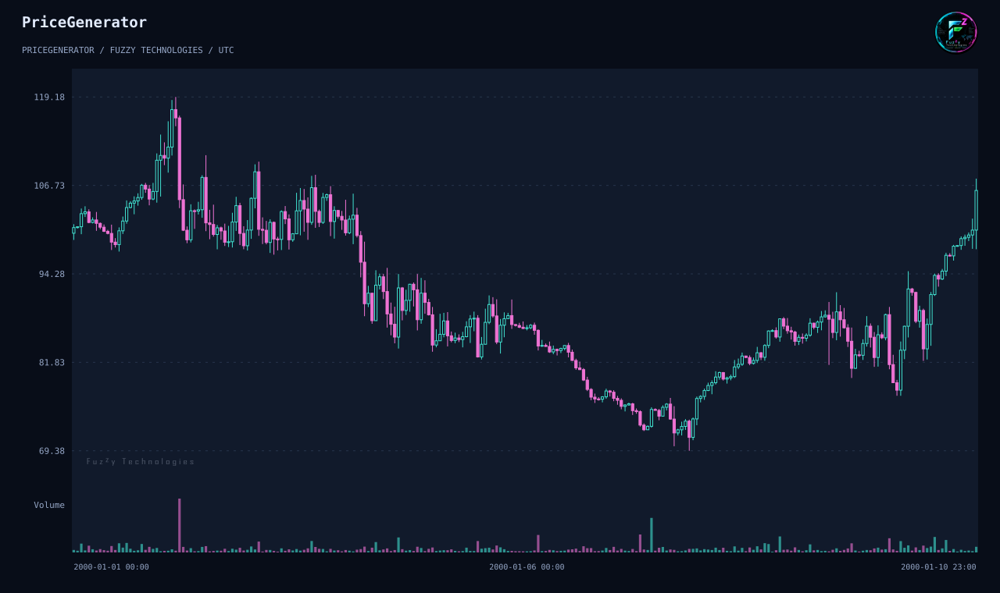
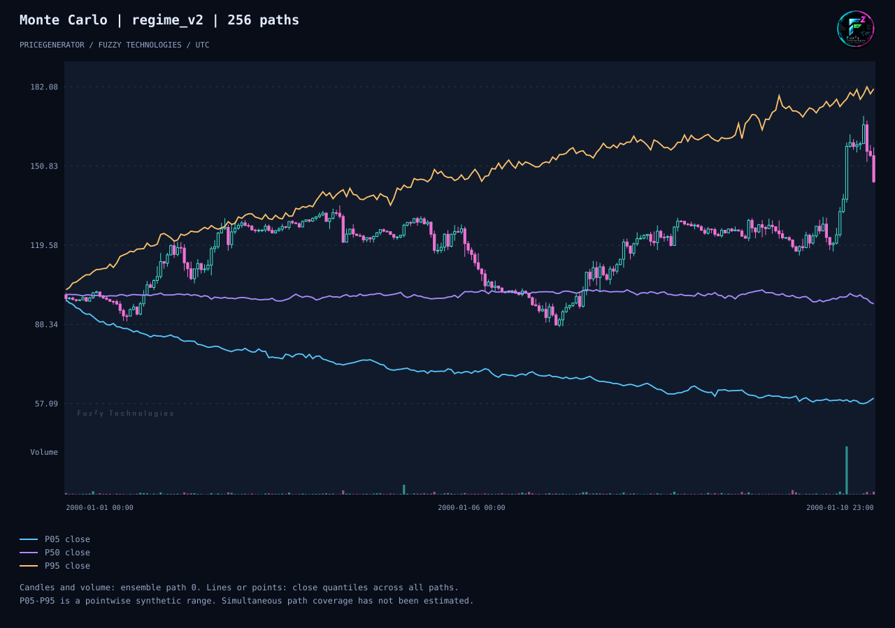

# Что входит в PriceGenerator 2.1

[English](../en/release-2-1.md) · [简体中文](../zh-CN/release-2-1.md)

В историческом выпуске 1.4.93 на PyPI были изменяемый генератор и прежние
методы построения графиков. В тестовом теге 2.0.0 на GitHub появились
неизменяемая конфигурация, генерация OHLCV по seed, точное воспроизведение,
потоковая запись и современные графики. В 2.1.0, первом запланированном
публичном выпуске ветки 2.x, добавлены воспроизводимые эксперименты
Монте‑Карло, опциональная нечёткая диагностика и ускорение экспорта.

## Один воспроизводимый сценарий

Установите проверяемую сборку 2.1 в отдельное окружение CPython 3.10–3.13.
[Быстрый старт](quick-start.md) показывает тестовую версию 2.0, а
[руководство по переходу](migrate-to-2-1.md) описывает совместимость и установку.

```sh
pricegenerator generate --seed 42 --horizon 240 --output prices.csv --manifest scenario.json
pricegenerator replay scenario.json --output replay.csv
pricegenerator validate prices.csv --timeframe-seconds 3600 --no-gaps
pricegenerator analyze prices.csv --output statistics.json
pricegenerator chart prices.csv --output scenario.svg --no-view
pricegenerator chart prices.csv --analysis --output scenario.html --no-view
```



Цена открытия первой свечи — 100, цена закрытия последней — 106,02.
Максимальная просадка по ценам закрытия — 39,30%. Команда replay восстановила
CSV побайтово. В автономном HTML есть аналитика, а SVG показывает цену и объём.

## Монте‑Карло на 256 траекториях

```sh
pricegenerator monte-carlo --seed 42 --horizon 240 --paths 256 --workers 2 --output ensemble.json --manifest experiment.json --chart quantiles.html
pricegenerator replay-ensemble experiment.json --workers 1 --output replayed-ensemble.json --chart quantiles.svg
```



Квантили последней цены закрытия — 59,22, 96,46 и 181,26. Квантили
максимальных просадок по траекториям — 15,56%, 31,00% и 52,18%. При
воспроизведении одним процессом отчёт побайтово совпал с результатом двух.
Квантили цен вычислены отдельно на каждом шаге в рамках `regime_v2`.
Они не задают вероятность попадания всей траектории в диапазон.
[Описание ансамбля](../../../monte-carlo.md).

## Опциональная нечёткая диагностика

Установите extra `fuzzy` на CPython 3.13. В
[примере Мамдани](../../../fuzzy-diagnostics.md) FuzzyRoutines 2.1.0
возвращает оценку около 0,587 и трассу правил. Входы — отношения
волатильности и активности к опорным значениям. Оценка описывает эти
входы и не меняет свечи. [Проверка на отложенных данных Bitstamp](../../../evidence/reference-bitstamp-holdout.md)
показывает ограничения симуляции и описательную проверку нечёткого профиля.

## Совместимость и проверка

| Область      | 1.4.93                    | 2.1                                                              |
| ------------ | ------------------------- | ---------------------------------------------------------------- |
| Генерация    | Изменяемый объект         | `GenerationConfig`, `Generate` и потоковые адаптеры              |
| CLI          | Прежние флаги             | Подкоманды и версионируемые манифесты                            |
| Графики      | Прежние методы рендеринга | Автономный HTML, SVG и опциональные PNG и JPEG                   |
| Исследования | Историческая статистика   | Воспроизводимые эксперименты, просадки, квантили и трассы правил |

Графики получены командами выше из проверяемой сборки 2.1.0.dev0.
Окружение — CPython 3.12.14, NumPy 2.2.6 и pandas 2.2.3.
[Анимация CLI](../../../examples/cli-demo.md) снята отдельно на тестовом
теге 2.0.0. [Научное руководство](scenario-guide.md) описывает допущения,
обмен с MT5 и сборку справочника API. Порядок продвижения и публикации на
PyPI описан в [инструкции выпуска](../../../releasing.md).
