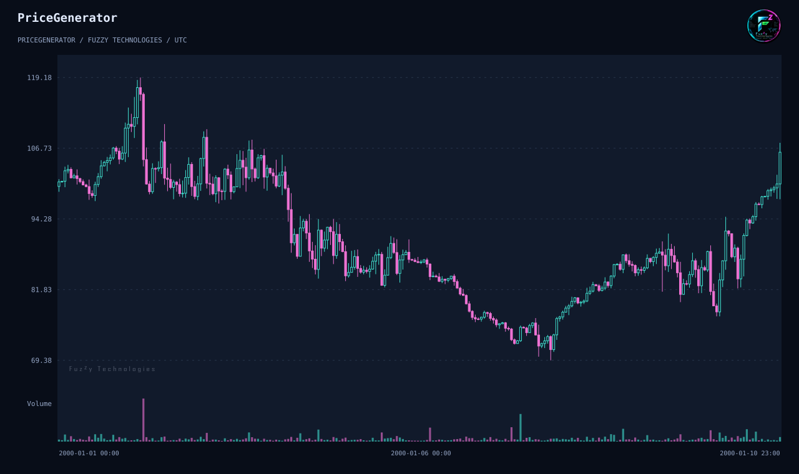
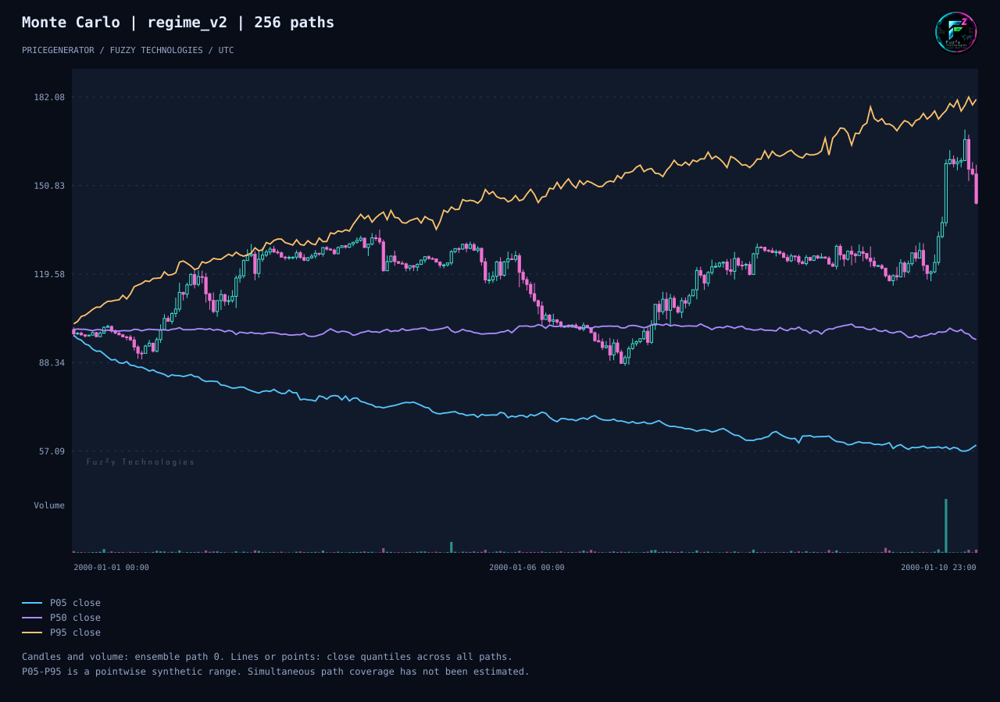

# PriceGenerator 2.1 发布预览

[English](../en/release-2-1.md) · [Русский](../ru/release-2-1.md)

PyPI 上的历史版本 1.4.93 使用可变的生成器和旧式绘图方法。
GitHub 测试标签 2.0.0 引入不可变配置、按种子生成 OHLCV、精确重放、流式输出和现代图表。
2.1.0 是计划公开发布的首个 2.x 版本，加入可复现的蒙特卡洛实验、可选模糊诊断和经过测量的导出优化。

## 复现单个场景

在独立的 CPython 3.10–3.13 环境中安装待审的 2.1 开发构建。
[快速入门](quick-start.md)演示 2.0 测试版本。
[迁移指南](migrate-to-2-1.md)说明安装与兼容性。

```sh
pricegenerator generate --seed 42 --horizon 240 --output prices.csv --manifest scenario.json
pricegenerator replay scenario.json --output replay.csv
pricegenerator validate prices.csv --timeframe-seconds 3600 --no-gaps
pricegenerator analyze prices.csv --output statistics.json
pricegenerator chart prices.csv --output scenario.svg --no-view
pricegenerator chart prices.csv --analysis --output scenario.html --no-view
```



首根开盘价为 100，末根收盘价为 106.02，按收盘价计算的最大回撤为 39.30%。
重放生成的 CSV 与原文件逐字节一致。离线 HTML 包含分析结果，SVG 显示价格与成交量。

## 重放 256 条蒙特卡洛路径

```sh
pricegenerator monte-carlo --seed 42 --horizon 240 --paths 256 --workers 2 --output ensemble.json --manifest experiment.json --chart quantiles.html
pricegenerator replay-ensemble experiment.json --workers 1 --output replayed-ensemble.json --chart quantiles.svg
```



最后一个时点的收盘价分位数为 59.22、96.46 和 181.26。
各路径最大回撤的分位数为 15.56%、31.00% 和 52.18%。
单进程重放与双进程运行的报告逐字节一致。
收盘价分位数是在 `regime_v2` 模型条件下逐时点计算的，不能解释为整条路径落在区间内的概率。
参见[集合实验说明](../../../monte-carlo.md)。

## 可选模糊诊断

在 CPython 3.13 上安装 `fuzzy` 可选依赖。
在 [Mamdani 示例](../../../fuzzy-diagnostics.md)中，FuzzyRoutines 2.1.0
返回约 0.587 的评分及规则触发记录。输入为波动率和活跃度相对于各自基准的比值。
评分描述这两个输入，不参与生成 K 线。
[Bitstamp 留出检验](../../../evidence/reference-bitstamp-holdout.md)
给出受限模拟模型的局限和对模糊评分的描述性分析。

## 兼容性和证据

| 范围   | 1.4.93       | 2.1                                          |
| ------ | ------------ | -------------------------------------------- |
| 生成   | 可变生成器   | `GenerationConfig`、`Generate` 和流式接口    |
| 命令行 | 旧参数       | 子命令和带版本的重放清单                     |
| 图表   | 旧式绘图方法 | 离线 HTML、SVG 及可选 PNG 和 JPEG            |
| 研究   | 历史统计功能 | 可复现实验、回撤、逐时点分位数和可选规则记录 |

以上两图由所列命令在 2.1.0.dev0 审查构建中导出。
环境为 CPython 3.12.14、NumPy 2.2.6 和 pandas 2.2.3。
[命令行动画](../../../examples/cli-demo.md)另用 2.0.0 测试标签录制。
[科学与使用指南](scenario-guide.md)介绍模型假设、MT5 数据交换与 API 参考文档构建。
代码推广与 PyPI 发布步骤见[发布手册](../../../releasing.md)。
